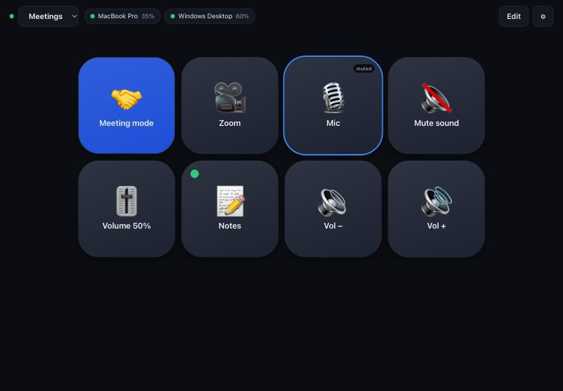
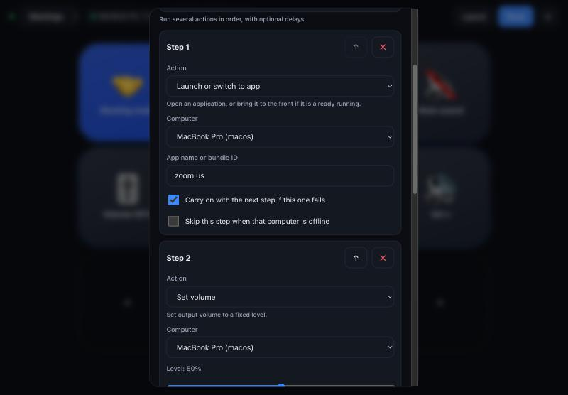

# NRVL Stream Deck

Self-hosted control surface: an iPad (PWA) presses buttons, a hub on your Mac routes them, and a small native
agent on each computer executes them. Everything stays on your home network. No cloud, no accounts.





Status: all six phases are built. Hub, iPad app and macOS agent are tested. The Windows agent and its installer
**have never been compiled or run** (see [TODO.md](TODO.md)). Not yet tried on a real iPad.

## Install (hub Mac)

Needs Node.js 24+ and Xcode (or its Command Line Tools). One command builds everything, starts the hub at
login, pairs this Mac as the first computer and prints the QR code for your iPad:

```bash
./scripts/install-mac.sh
```

Then:

1. **New iPad:** open `http://<your-mac>.local:8080` on it and follow the three certificate steps (once per iPad).
2. Scan the QR code with the iPad camera, then Safari → Share → **Add to Home Screen**.
3. For keyboard shortcuts, media keys, typing and lock, enable
   `~/Library/Application Support/NRVLStreamDeck/nrvl-agent` under **System Settings → Privacy & Security →
   Accessibility**. Volume, app launching, websites and scripts work without it.

**Update:** get the new code and run `./scripts/install-mac.sh` again (re-enable Accessibility afterwards; macOS
ties the permission to the exact binary). The iPad app updates itself the next time it opens.
**Remove:** `./scripts/uninstall-mac.sh` (keeps your data).

### More computers

Another Mac: copy this folder to it, `swift build -c release --package-path agents/macos`, then on the hub run
`npm run pair agent` and on that Mac `agents/macos/.build/release/nrvl-agent pair nrvl1.…` followed by
`… nrvl-agent install`.

Windows PC (**untested**), with the [.NET 8 SDK](https://dotnet.microsoft.com/download) and this folder copied over:

```powershell
powershell -ExecutionPolicy Bypass -File scripts\install-windows.ps1 -PairingString nrvl1.…
```

The PC must be on the same network and able to resolve `<your-mac>.local`. App buttons take a Start Menu name
("Visual Studio Code"), a program name ("notepad") or the full path of an .exe; Store apps without a Start Menu
shortcut file are not launchable yet. `cmd` in a shortcut means the Windows key.

## Using the deck

- **Tap** a button to run it. **Long-press** it to edit it.
- **Edit** (top right) switches to arranging: tap a button or a **+** to edit, drag a button to move it, drop it
  on another button to swap them. **Layout** changes the profile name, grid size and pages, and creates,
  duplicates or deletes profiles.
- A button with the action **Open folder** leads to its own page of buttons; **‹ Back** returns.
- **Macro** buttons run several actions in order (on any mix of computers) with waits in between. Each step can
  carry on after a failure or be skipped when its computer is offline. A bar shows the current step and a Cancel
  button. Macros run on the hub, so they finish even if the iPad drops off Wi-Fi.
- **Also run on** in the button editor sends one action to several computers. Lock, sleep and scripts ask for
  confirmation first when more than one computer is involved.
- Buttons show live state: a ring when sound or microphone is muted, a green dot when an app button's app is running.
- **Layout → New profile** offers ready-made templates (Productivity, Development, Meetings, Media, Browser,
  System) built for the computer you pick. **Export to file / Import from file** move a profile between hubs;
  on import, buttons that point at unknown computers are aimed at your first computer.

### Scripts

A button can only run scripts you have allow-listed on that computer. Add them by name to its `agent.json`
(`~/Library/Application Support/NRVLStreamDeck/` on macOS, `%APPDATA%\NRVLStreamDeck\` on Windows) and restart
the agent; only the name travels over the network, never a path or arguments.

```json
"scripts": { "Backup": "/Users/me/bin/backup.sh" }
```

The file must be executable (`.exe`, `.bat` or `.cmd` on Windows), exit with 0 for success, and finish within
8 seconds (start long jobs in the background from inside the script).

To restrict what a computer accepts at all, add `"allowedActions": ["volume.set", "volume.mute"]` to the same file.

## Commands

| Command | What it does |
| --- | --- |
| `npm run pair controller` / `agent` | One-time pairing code, valid 10 minutes |
| `npm run devices` / `npm run revoke <id>` | List / remove paired devices (also in the app's Settings) |
| `npm run audit [count]` | Latest audit log entries: pairings, failed logins, every action run |
| `npm run backup [file.tgz]` / `npm run restore <file.tgz>` | Backup and restore (below) |
| `npm run service install` / `uninstall` / `status` | Hub auto-start at login |
| `nrvl-agent status` / `install` / `uninstall` | Agent state and auto-start |

Settings (environment variables): `NRVL_DATA_DIR` (default `~/.nrvl-stream-deck`), `NRVL_PORT` (8443),
`NRVL_HTTP_PORT` (8080), `NRVL_HOST`. Logs: `~/Library/Logs/nrvl-hub.log` and `nrvl-agent.log`.

## Backup and recovery

The hub snapshots its database and certificates into `~/.nrvl-stream-deck/backups/` at every start and once a
day, keeping seven. For a copy on another disk run `npm run backup ~/somewhere/safe.tgz`. Keep that file
private: it contains the hub's certificate key.

| Situation | What to do |
| --- | --- |
| Deleted a profile or made a mess | `npm run service uninstall`, `npm run restore ~/.nrvl-stream-deck/backups/auto-<date>`, `npm run service install` |
| New or wiped hub Mac | Install as above, stop the hub, `npm run restore <file.tgz>`, start it. If the Mac's name changed, also see the next row |
| The hub Mac was renamed | The hub reissues its certificate by itself. iPad: open the new address and add it to the Home Screen again. Agents: edit `hubURL` in `agent.json` (or pair again) |
| Lost or sold an iPad | Settings → Devices → Remove on another controller, or `npm run revoke <id>`. Its access ends at once |
| A computer shows offline | On it: `nrvl-agent status`, then check `~/Library/Logs/nrvl-agent.log`. "unauthorized" means it was removed: pair it again |
| iPad says the connection is not private | The certificate is not installed or not switched on: repeat the steps at `http://<your-mac>.local:8080` |
| Shortcuts stopped working after an update | Re-enable the agent under Accessibility (remove the old entry first if needed) |
| Everything is broken | A restore keeps the replaced data in `~/.nrvl-stream-deck/replaced-<time>/`; nothing is deleted by a restore |

The hub's certificate renews itself; the certificate authority installed on the iPad is valid for ten years.

## Development

```bash
npm run hub               # terminal 1 (or leave the installed service running)
npm run dev               # terminal 2: UI on http://localhost:5173, no iPad needed
npm run check             # typecheck + 31 hub/contract tests + 8 agent tests + build
npm run test:e2e          # with hub + agent running: volume, mic, a macro, scripts and live state on this Mac
node apps/hub/test/perf.ts   # button-press latency through the whole stack
```

## License

Open source under the [MIT License](LICENSE): free for anyone to use, change and share, including commercially.

Design, protocol and file formats: [ARCHITECTURE.md](ARCHITECTURE.md). Security model and review:
[SECURITY.md](SECURITY.md). Pending work: [TODO.md](TODO.md).
